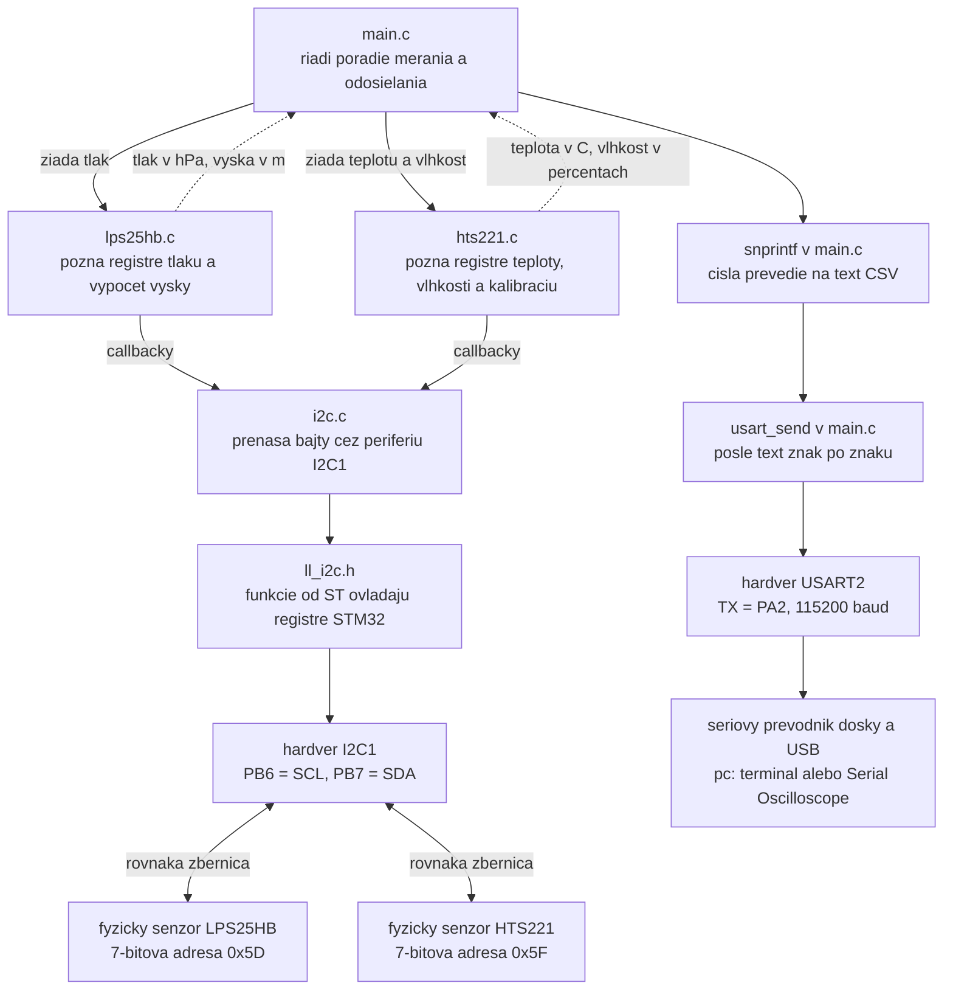
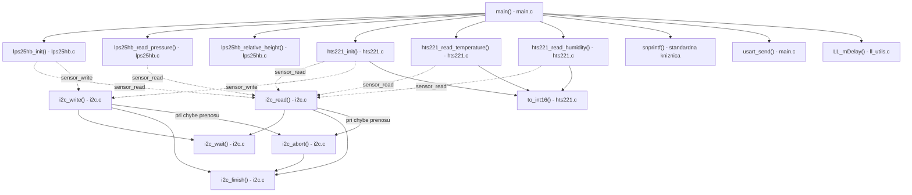
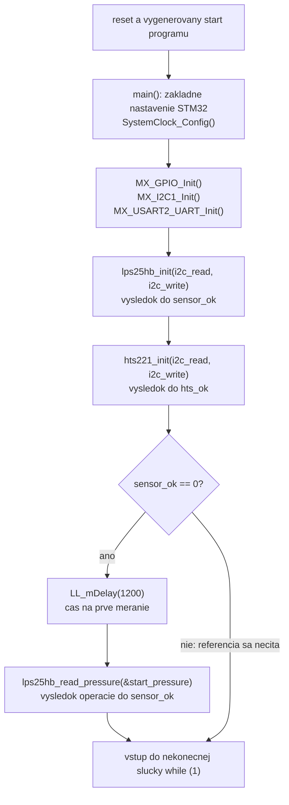
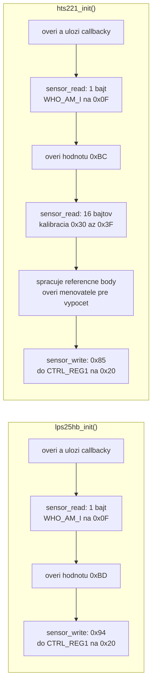
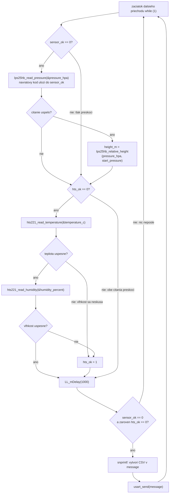
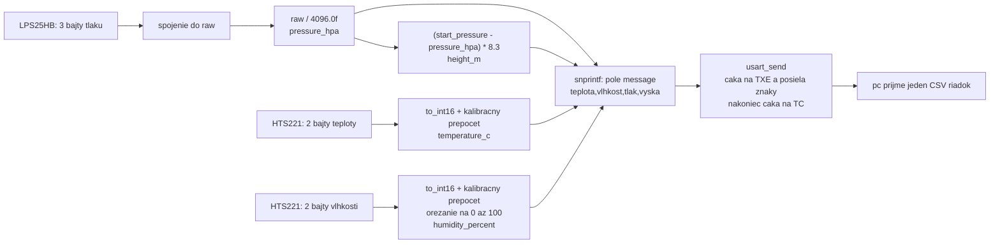

# ako funguje tento projekt

Program cita tlak zo senzora LPS25HB, teplotu a vlhkost zo senzora HTS221, vypocita relativnu vysku a posle styri hodnoty do pc. Diagramy popisuju aktualny kod vratane spravania pri chybe.

Diagramy su zapisane v Mermaid. Zobrazia sa napr. v Markdown nahlade na GitHube; lokalny editor musi podporovat Mermaid. Pod diagramami je aj textove vysvetlenie.

## 1. celkovy obraz: kto co robi

V tomto diagrame sipky oznacuju cestu poziadaviek a dat, nie jednotlive volania funkcii.



- `main.c` urcuje, **co a kedy** sa ma vykonat.
- ovladace senzorov urcuju, **ktore registre** treba citat a **ako prepocitat bajty** na veliciny.
- `i2c.c` urcuje, **ako preniest bajty** pomocou konkretneho STM32.
- senzory zdielaju vodice, ale maju rozne adresy. Prenosy sa vykonavaju postupne.
- kod STM32 posiela UART, nie priamo USB. USB cast zabezpecuje prevodnik pri zodpovedajucom zapojeni dosky.

## 2. kde su funkcie a co volaju

**Deklaracia** v `.h` hovori, ako funkciu zavolat. **Definicia** je telo funkcie, ktore sa vykona. Pri vlastnych funkciach je v `.c`; niektore LL funkcie od ST maju telo priamo v `.h` ako `inline`.

| funkcia | kde je definovana | co vola alebo robi |
|---|---|---|
| `main()` | [Core/Src/main.c](Core/Src/main.c) | inicializacie, citanie senzorov, vypocet vysky, `LL_mDelay`, `snprintf`, `usart_send` |
| `usart_send()` | [Core/Src/main.c](Core/Src/main.c) | kontroluje USART priznaky a vola `LL_USART_TransmitData8` |
| `lps25hb_init()` | [LPS25HB/lps25hb.c](LPS25HB/lps25hb.c) | ulozi callbacky, cez ne cita identitu a zapise nastavenie |
| `lps25hb_read_pressure()` | [LPS25HB/lps25hb.c](LPS25HB/lps25hb.c) | cez `sensor_read` zavola `i2c_read`, spoji bajty, vydeli 4096 |
| `lps25hb_relative_height()` | [LPS25HB/lps25hb.c](LPS25HB/lps25hb.c) | iba matematika: `(referencny tlak - aktualny tlak) * 8.3` |
| `hts221_init()` | [HTS221/hts221.c](HTS221/hts221.c) | callbacky, identita, kalibracia, `to_int16`, zapis nastavenia |
| `hts221_read_temperature()` | [HTS221/hts221.c](HTS221/hts221.c) | `sensor_read`, `to_int16`, prepocet podla kalibracie |
| `hts221_read_humidity()` | [HTS221/hts221.c](HTS221/hts221.c) | `sensor_read`, `to_int16`, prepocet a orezanie na 0 az 100 percent |
| `to_int16()` | [HTS221/hts221.c](HTS221/hts221.c) | spoji dva bajty do cisla so znamienkom; iba pre tento subor |
| `i2c_read()` | [Core/Src/i2c.c](Core/Src/i2c.c) | `i2c_finish`, `i2c_wait`, LL prenosove funkcie; pri chybe `i2c_abort` |
| `i2c_write()` | [Core/Src/i2c.c](Core/Src/i2c.c) | rovnake pomocne funkcie, ale odosiela data |
| `i2c_wait()` | [Core/Src/i2c.c](Core/Src/i2c.c) | cita stavovy register `I2C1->ISR`, kontroluje chyby a pocitadlo cakania |
| `i2c_finish()` | [Core/Src/i2c.c](Core/Src/i2c.c) | cez LL funkcie maze priznaky STOP, NACK, BERR a ARLO |
| `i2c_abort()` | [Core/Src/i2c.c](Core/Src/i2c.c) | skontroluje BUSY, pripadne vyziada STOP, zavola `i2c_finish` |

Hlavicky vlastnych rozhrani: [lps25hb.h](LPS25HB/lps25hb.h), [hts221.h](HTS221/hts221.h), [i2c.h](Core/Inc/i2c.h). Obsahuju deklaracie; senzorove hlavicky aj adresy registrov a typy callbackov.

| podklad od CubeMX alebo ST | kde je definovany | uloha |
|---|---|---|
| `SystemClock_Config()` | [Core/Src/main.c](Core/Src/main.c) | nastavenie hodin a milisekundovej casovej zakladne |
| `MX_GPIO_Init()` | [Core/Src/gpio.c](Core/Src/gpio.c) | inicializacia GPIO |
| `MX_I2C1_Init()` | [Core/Src/i2c.c](Core/Src/i2c.c) | nastavenie I2C a jeho pinov; vlastny doplnok povoli periferiu |
| `MX_USART2_UART_Init()` | [Core/Src/usart.c](Core/Src/usart.c) | nastavenie seriovej linky a jej pinov |
| `LL_I2C_HandleTransfer`, `LL_I2C_TransmitData8`, `LL_I2C_ReceiveData8` | [stm32f3xx_ll_i2c.h](Drivers/STM32F3xx_HAL_Driver/Inc/stm32f3xx_ll_i2c.h) | nastavenie prenosu a pristup k datovym registrom I2C |
| `LL_USART_TransmitData8` a kontroly USART priznakov | [stm32f3xx_ll_usart.h](Drivers/STM32F3xx_HAL_Driver/Inc/stm32f3xx_ll_usart.h) | vysielanie cez USART |
| `LL_mDelay()` | [stm32f3xx_ll_utils.c](Drivers/STM32F3xx_HAL_Driver/Src/stm32f3xx_ll_utils.c) | blokujuca pauza v milisekundach |
| `snprintf()` | standardna C kniznica, deklaracia v `stdio.h` | vytvori text v poli `message`; neposiela ho |

## 3. mapa volani vlastnych funkcii

Plna sipka znamena volanie. Prerusovana sipka znamena volanie cez ulozeny ukazovatel na funkciu, teda callback. Mapa ukazuje vztahy, nie casove poradie; casove poradie je v dalsich diagramoch.



LL funkcie su pre citatelnost vynechane z tejto mapy. `i2c_read/write` navyse volaju LL funkcie I2C, `usart_send` vola LL funkcie USART. Neplatne vstupne parametre mozu ukoncit funkciu hned, bez prenosu a bez `i2c_abort`.

### preco je tam sensor_read, ked skutocna funkcia sa vola i2c_read

```text
main.c: lps25hb_init(i2c_read, i2c_write)
                         |          |
                         v          v
lps25hb.c: sensor_read = read; sensor_write = write;
                         |                     |
                         v                     v
neskorsie sensor_read(...) vykona i2c_read(...)
neskorsie sensor_write(...) vykona i2c_write(...)
```

`sensor_read` a `sensor_write` su premenne obsahujuce ukazovatele na funkcie. Nie su to dalsie samostatne implementacie prenosu. Odovzdanie mena `i2c_read` bez zatvoriek funkciu este nevykona, len odovzda jej adresu.

HTS221 ma vo svojom `.c` subore vlastne callbackove premenne s rovnakymi menami. Vdaka `static` sa s premennymi LPS25HB nepomiesaju. Obe kniznice nakoniec pouzivaju tie iste `i2c_read/write` z `i2c.c`.

## 4. co sa deje raz po zapnuti



Obe inicializacie sa skusia postupne, aj ked prva zlyha. Navratova hodnota vlastnych stavovych funkcii je **0 = uspech, 1 = chyba**. Vynimkou je napr. `lps25hb_relative_height`, ktora vracia priamo vysku.

`start_pressure` sa po tomto uvodnom citani uz nemeni. Poloha pri starte je vyskovou nulou; program nevie, kde je skutocna zem ani aka je nadmorska vyska.

### co robia inicializacie senzorov



Tento diagram ukazuje uspesne vetvy. Chybajuci callback, chyba prenosu, nespravne ID alebo neplatna kontrolovana kalibracia ukonci danu inicializaciu s hodnotou 1. Ak zlyha zapis nastavenia, jeho chybovy kod sa vrati volajucemu.

`0x0F` je **adresa registra v senzore**. `0xBD` alebo `0xBC` je **ocakavany obsah registra**. `#define` tieto cisla iba pomenovava, nic nimi nezapisuje do senzora.

Oba nastavovacie bajty zapnu meranie 1 Hz a BDU. Su rozne, pretoze senzory maju inak rozlozene bity nastavenia. BDU chrani casti jednej viacbajtovej hodnoty pred pomiesanim pri citani.

## 5. co sa opakuje pocas behu



**Dolezite vlastnosti aktualneho kodu:**

- po chybe sa dany senzor znovu neskusa, pretoze jeho stav ostane 1;
- pri chybe jedneho senzora sa prestane posielat cely CSV riadok, aj ked druhy funguje;
- slucka pokracuje aj po chybe, iba preskakuje prislusne operacie;
- sekundove cakanie je az po citani a pred odoslanim;
- jeden priechod trva trochu viac nez sekundu, lebo aj zvysne operacie potrebuju cas;
- kod nekontroluje priznak noveho merania senzora, spolieha sa na nastavenu frekvenciu a pauzu;
- procesor caka na I2C a USART priznaky priamo v cykloch: ide o polling, nie prenos cez vlastne obsluhy preruseni alebo DMA.

## 6. jeden konkretny priklad: od volania po tlak v premennej

Diagram ukazuje uspesne citanie. Plna sipka je volanie alebo poziadavka, prerusovana je odpoved/navrat.

```mermaid
sequenceDiagram
    participant M as main.c
    participant D as lps25hb.c
    participant I as i2c.c
    participant HW as I2C1 hardver STM32
    participant S as senzor LPS25HB
    M->>D: lps25hb_read_pressure(&pressure_hpa)
    Note over M,D: & odovzda adresu premennej pre vysledok
    D->>I: sensor_read(adresa, 0x28 OR 0x80, data, 3)
    Note over D,I: ulozeny callback vykona i2c_read()
    I->>I: i2c_finish()
    I->>HW: LL_I2C_HandleTransfer: start a zapis 1 bajtu
    I->>I: i2c_wait(TXIS)
    I->>HW: LL_I2C_TransmitData8: register 0xA8
    HW->>S: adresa zariadenia a vyber registra s auto-increment
    I->>I: i2c_wait(TC)
    I->>HW: LL_I2C_HandleTransfer: opakovany start a citanie 3 bajtov
    S-->>HW: bajty registrov 0x28, 0x29, 0x2A
    loop pre kazdy z troch bajtov
        I->>I: i2c_wait(RXNE)
        I->>HW: LL_I2C_ReceiveData8()
        HW-->>I: jeden bajt do data[i]
    end
    Note over HW,S: autoend ukonci prenos cez STOP
    I->>I: i2c_wait(STOPF), i2c_finish()
    I-->>D: return 0; data uz obsahuje tri bajty
    D->>D: spoji bajty do raw, vydeli 4096.0f
    Note over M,D: *pressure zapise tlak priamo do pressure_hpa
    D-->>M: return 0 ulozeny do sensor_ok
```

Tri bajty prichadzaju postupne po zbernici. Aj ked ich procesor vybera jednotlivo, patria do **jedneho viacbajtoveho citania**, nie do troch samostatnych citani.

Funkcia odovzda dve rozne informacie:

```text
lps25hb_read_pressure(&pressure_hpa)
                       |
                       +--> namerany tlak sa zapise do pressure_hpa

return 0 alebo 1 ----------> stav operacie sa ulozi do sensor_ok
```

## 7. zapis a citanie na I2C v skratke

```text
i2c_write(adresa, register, data, pocet):

START -> adresa senzora + smer zapis -> register -> data[0] -> ... -> STOP
                                                 |          |
                                                 +----------+
                                        spolu pocet + 1 bajtov

i2c_read(adresa, register, data, pocet):

START -> adresa senzora + smer zapis -> register
       -> opakovany START -> adresa senzora + smer citanie
       -> prijem data[0] -> ... -> prijem posledneho bajtu -> STOP
```

Citanie zacina zapisom, pretoze senzoru najprv treba poslat **adresu registra**, ktory chces citat. V tejto faze nemenis obsah registra.

V oboch funkciach sa pri chybe pocas prenosu vykona `goto error`, potom `i2c_abort()` a `return 1`. `i2c_wait()` kontroluje chyby a pocet pokusov; `I2C_TIMEOUT` nie je cas v milisekundach. Vymazanie priznakov cez `i2c_finish()` samo neopravi odpojeny senzor ani fyzicky zaseknutu zbernicu.

## 8. z bajtov sa stanu cisla a z cisel text



Pri HTS221 sa kalibracne body nacitaju **raz pri inicializacii**. Funkcie citania ich neskor pouzivaju z ulozenych `static` premennych. Medzi dvoma znamymi bodmi prepocitaju surovu hodnotu na teplotu alebo vlhkost.

Ilustracny vysledok:

```text
start_pressure = 1000.00 hPa
pressure_hpa   =  999.90 hPa
height_m       = (1000.00 - 999.90) * 8.3 = priblizne 0.83 m
temperature_c  = 23.4
humidity_percent = 48.2

snprintf vytvori: 23.4,48,999.90,0.83\r\n
usart_send tento text odosle
```

Format `%.1f,%.0f,%.2f,%.2f` urcuje pocet desatinnych miest. `\r\n` ukoncuje riadok. `snprintf` prida aj nulovy znak konca textu; `usart_send` ho neposiela. TXE znamena moznost vlozit dalsi bajt, TC znamena uplne dokoncenie vysielania.

Vyska je priblizna a relativna k startu. Dve desatinne miesta vo vystupe neznamenaju centimetrovu presnost merania.
